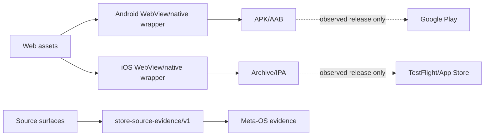

# 📱 SINERGY Finance / synergy_app — verified mobile-release dossier

> **Статус:** 🟡 CANDIDATE source/release surface. Android, iOS, web assets, tests, federation source-integrity contract and release workflows exist.
> **Проверено по фактическому `main`:** 29.09.2026.
> **Ключевая граница:** source verified ≠ artifact built ≠ store published.

## 1. 🎯 Задача

`synergy_app` — multi-platform application source для SINERGY Finance. Repository уже существенно глубже обычного UI shell: содержит Android/iOS projects, web assets, release automation, store tooling и tests.

Его задача — быть безопасным presentation/control surface, не вторым financial ledger.

## 2. 📦 Фактический tree

```text
synergy_app/
├── android/
│   ├── app/
│   ├── build.gradle
│   └── ...
├── ios/
│   ├── SinergyFinance.xcodeproj/
│   └── SinergyFinance/
│       ├── AppDelegate.swift
│       ├── WebViewController.swift
│       ├── Info.plist
│       └── PrivacyInfo.xcprivacy
├── www/
│   ├── index.html
│   ├── css/
│   ├── js/
│   └── wallet/
├── federation/release_contract.py
├── tests/
├── scripts/
├── docs/RELEASE-SECRETS.md
├── RELEASE_SETUP.md
└── .github/workflows/
```

## 3. 🤖 Android baseline

`android/app/build.gradle`:

```text
namespace       ai.sinergy.finance
applicationId   ai.sinergy.finance
compileSdk      36
targetSdk       36
minSdk          26
versionCode     810
versionName     8.1.0
Java            17
```

Release signing is injected through environment variables only if a keystore file is provided.

Current build config:

- `minifyEnabled false`;
- `shrinkResources false`;
- AndroidX WebKit dependency;
- JUnit test dependency.

## 4. 🛡️ Android manifest security baseline

Inspected `AndroidManifest.xml`:

- INTERNET only in visible permission list;
- `android:allowBackup="false"`;
- `android:usesCleartextTraffic="false"`;
- explicit network security config;
- launcher activity exported;
- portrait orientation.

Federation release contract explicitly rejects dangerous permission strings:

```text
CAMERA
RECORD_AUDIO
READ_CONTACTS
ACCESS_FINE_LOCATION
READ_SMS
```

если они появятся в manifest.

## 5. 🍎 iOS baseline

Inspected iOS tree includes:

- AppDelegate;
- WebViewController;
- Info.plist;
- Xcode project;
- PrivacyInfo.xcprivacy.

Current PrivacyInfo declares:

```text
NSPrivacyTracking = false
tracking domains = []
collected data types = []
accessed API types = []
```

Это **source declaration**, not external privacy audit.

## 6. 🔗 Federation source-integrity contract

`federation/release_contract.py`:

```text
CONTRACT_ID = synergy.app.store-source-evidence/v1
AUTHORITY   = mobile_source_integrity
```

It requires:

- Android app Gradle;
- Android manifest;
- iOS pbxproj;
- iOS privacy manifest.

Then checks:

- versionName exists;
- compileSdk/targetSdk = 36;
- no cleartext;
- backup disabled;
- selected dangerous permissions absent.

It hashes four source surfaces and returns:

```text
source_verified = true
artifact_built = false
store_published = false
deployment_authority = false
```

## 7. 🧪 Maturity-boundary test

`tests/test_federation_release_contract.py` explicitly asserts all four fields above.

This prevents documentation from claiming Google Play/App Store release merely because source structure is valid.

## 8. ⚙️ CI / release workflows

Repository contains:

- `verify.yml`;
- `android-aab.yml`;
- `ios-archive.yml`;
- `release.yml`;
- `store-release.yml`.

`verify.yml` runs:

- source verification script;
- NEXUS latent reasoning E2E script;
- currency UI test;
- capital curve test;
- JS wallet creation regression test.

`RELEASE_SETUP.md` documents Android signing, Google Play service account, iOS certificate/App Store Connect secrets and GitHub Release flow.

The existence of these workflows means release automation is designed; it does not itself prove current successful publication.

## 9. 🔐 Release secret model

Documentation correctly requires secrets to live in GitHub Actions secrets, including:

- Android keystore material/passwords;
- Google Play service account JSON;
- Apple certificate/API key material.

Rule:

```text
release credentials must never be committed to Git
```

This should be enforced by secret scanning, not only prose.

## 10. 🏗️ Architecture



## 11. 📥 Inputs / 📤 Outputs

Inputs:

- web source;
- Android/iOS project metadata;
- release environment/secrets;
- verified backend/read-model state.

Outputs:

- source-integrity evidence;
- local/platform build artifacts;
- optional store/release artifacts if workflows succeed.

## 12. 🛡️ Authority boundaries

```text
UI state          != financial truth
source verified   != artifact built
artifact built    != signed artifact
signed artifact   != store published
store published   != backend correctness
wallet UI         != private-key authority by default
deployment_authority = false
```

## 13. ⚠️ Failure modes

| Failure | Risk |
|---|---|
| SDK baseline drifts | release compatibility |
| dangerous permission added | privacy regression |
| cleartext enabled | MITM/data leak |
| signing secret committed | credential compromise |
| web asset drift Android/iOS | platform inconsistency |
| stale WebView bundle | UI/API mismatch |
| store upload succeeds but app broken | release ≠ functional validation |
| version mismatch | rollout/reproducibility problem |

## 14. 🧪 Required next validation

- deterministic Android AAB hash;
- iOS archive provenance;
- web asset parity Android/iOS;
- signing-certificate fingerprint evidence;
- app install smoke;
- Android API 26/36 matrix;
- iOS supported-version smoke;
- network-security negative test;
- no-secret scan;
- store-source vs uploaded artifact hash;
- wallet end-to-end security test.

## 15. 🛠️ Reproducibility

Source verification:

```bash
python scripts/verify_store_source.py
python tests/test_federation_release_contract.py
```

Android:

```bash
bash scripts/build_android_aab.sh
```

iOS archive script exists as `scripts/build_ios_archive.sh`.

Canonical release requirements are in `RELEASE_SETUP.md`.

## 16. 🗺️ Repository map

| Path | Role |
|---|---|
| `android/` | Android app |
| `ios/` | iOS app |
| `www/` | shared/web UI |
| `federation/release_contract.py` | source integrity evidence |
| `tests/` | UI/release regressions |
| `scripts/` | build/upload/source verification |
| `.github/workflows/` | verify/build/release/store pipelines |
| `RELEASE_SETUP.md` | release credentials/config documentation |

## 17. 🔗 Место в SYNERGY

Application-layer consumer of canonical state. Related authorities:

- `synergy_apps`;
- `synergy_meta_os`;
- `synergy_financial_os`;
- `synergy_pay_system`.

It does not become ledger/payment authority.

## 18. 📊 Evidence maturity

| Layer | Status |
|---|---|
| Android source | ✅ |
| iOS source | ✅ |
| web assets | ✅ |
| source integrity contract | ✅ |
| security source checks | ✅ |
| release workflows | ✅ definitions |
| observed signed build | separate evidence required |
| observed store publication | not inferred |
| backend E2E | separate evidence required |

## 19. 🚀 Roadmap

1. capture observed AAB/IPA hashes;
2. store artifact attestation;
3. store publication receipts;
4. install/device matrix;
5. release rollback;
6. privacy/security review;
7. source→artifact→store provenance chain;
8. M4/M5 observed evidence.

## 20. 🛑 Что проект НЕ утверждает

- that current branch is already published in stores;
- that source checks equal mobile penetration/security test;
- that privacy declaration independently proves zero data collection;
- that build workflow implies successful signed release;
- that UI can override domain authorities.

---

[🧭 SYNERGY SYSTEM](https://github.com/Shtenco/synergy_system) · [📚 Atlas](https://github.com/Shtenco/synergy_system/blob/main/docs/SYNERGY_REPOSITORY_ATLAS.md)
