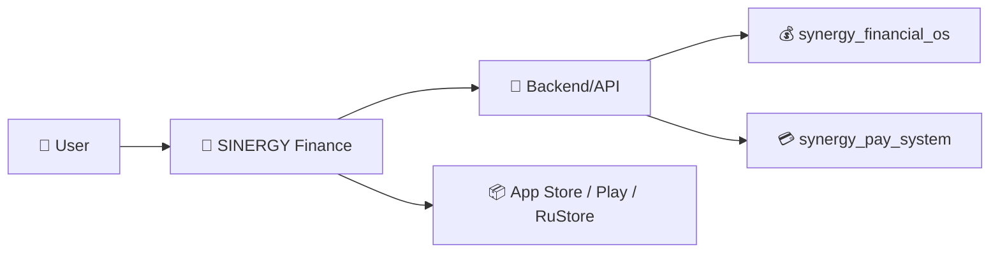

# SINERGY Finance

Store release repository for `ai.sinergy.finance`.

## Targets

- Apple App Store / TestFlight
- Google Play
- RuStore
- GitHub Releases (signed APK/AAB/IPA artifacts when platform signing is configured)

## Current release

- Version: `8.1.0`
- Android versionCode: `810`
- Android compile/target SDK: `36`
- iOS bundle ID: `ai.sinergy.finance`
- iOS deployment target: `16.0`

## CI/CD

The primary pipeline is `.github/workflows/store-release.yml`.

It performs:

1. store-source verification;
2. deterministic synchronization of `www/` into Android and iOS bundles;
3. signed Android APK + AAB build;
4. optional Google Play internal-track upload;
5. optional RuStore AAB upload;
6. signed iOS archive + IPA export;
7. optional App Store Connect / TestFlight upload;
8. GitHub Release artifact publication.

Store credentials and signing material are intentionally not committed. See `docs/RELEASE-SECRETS.md`.

## Source layout

- `android/` — Android store project
- `ios/` — Xcode project
- `www/` — shared web UI bundled into both platforms
- `store/` — listing/privacy/review metadata
- `scripts/` — build, asset sync and store upload tooling
- `tests/` — source smoke/regression checks

## Release safety

Do not commit keystores, `.p12`, `.p8`, provisioning profiles or store API credentials. Keep the Android upload key stable across releases.


---

# 🧭 Место SINERGY Finance в федерации SYNERGY

`synergy_app` — уже не абстрактный placeholder: в `main` присутствуют Android/iOS проекты, shared `www/`, release scripts, tests и store metadata. Его роль — **пользовательский финансовый интерфейс**, а не источник бухгалтерской истины.



## Authority boundary

```text
displayed balance != canonical ledger
UI success        != settlement
local cache       != accounting record
release artifact != trusted until signed/verified
```

## Что уже видно в репозитории

- Android store project;
- iOS Xcode project;
- shared web UI;
- release tooling;
- source smoke/regression checks;
- CI/CD store release workflow;
- документация по секретам/релизу.

## Следующие documentation gates

- связать API endpoints с authority owner;
- описать offline/cache semantics;
- добавить threat model мобильного клиента;
- закрепить release provenance;
- добавить privacy/data-flow diagram;
- описать idempotency денежных действий.

### Навигация

- [SYNERGY SYSTEM](https://github.com/Shtenco/synergy_system)
- [Атлас 75 репозиториев](https://github.com/Shtenco/synergy_system/blob/main/docs/SYNERGY_REPOSITORY_ATLAS.md)
