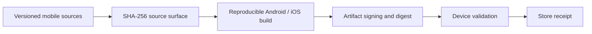

# SINERGY Finance — cross-platform release engineering

## Original engineering contribution

The repository contains real Android, iOS and web application surfaces, accompanied by a **source-integrity contract** that explicitly differentiates a valid source tree, compiled artifact and store publication. That three-level release vocabulary is valuable for regulated and financially sensitive user interfaces.

The [federation contract](../federation/release_contract.py) checks Android Gradle and manifest, iOS Xcode and privacy declarations. It binds them with SHA-256 digests, requires the Android SDK baseline to be 36, backup and cleartext traffic to be disabled, and rejects selected dangerous permissions. It outputs source_verified true but artifact_built, store_published and deployment_authority false.

## Build chain and evidence

The target supply-chain model is:

The source digest alone cannot imply a successful binary build. A release evidence record should contain commit SHA, build manifest, dependencies, binary digest, signing identity, platform version and publication response.

## Quantitative control

A file hash is $d=\operatorname{SHA256}(bytes)$. Equality of hashes to trusted expected digests is an integrity criterion for those bytes, not an assurance that the app contains no exploitable defects.

## Scientific and commercial potential

An independently verifiable mobile release pipeline is an important practical differentiator for fintech software. It provides the foundation for wallet UI, accounting views, authentication and policy-aware finance flows without turning the app into settlement authority.

## Acceptance tests

Replay source verification from a clean checkout. Build APK/AAB and iOS archive where signing resources exist; run UI and wallet regression tests; compare actual APK digest and permissions. Capture app-store publication separately. A verified source release is an **engineering milestone** even when store publication is pending.

[Release contract](../federation/release_contract.py) · [Release setup](../RELEASE_SETUP.md) · [Tests](../tests/test_federation_release_contract.py)
